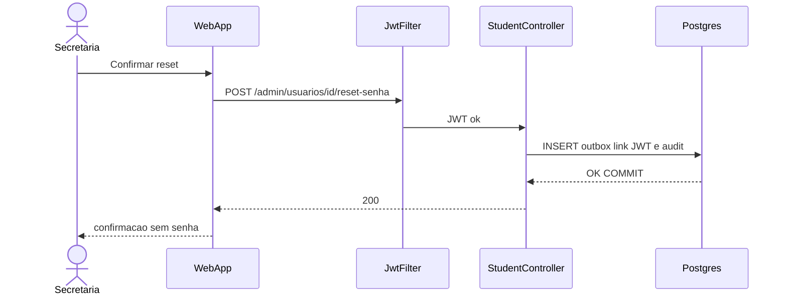

# F5.6-D04 — Reset de senha administrativo

| Campo | Valor |
|---|---|
| HU | US-F5-003 |
| Escopo | `POST /admin/usuarios/{id}/reset-senha` + outbox (link JWT) + audit |
| Atores | Secretaria, WebApp, JwtFilter, StudentController, Postgres |
| Pré-condições | `user.reset_password` / `_links.reset-password`; aluno no escopo |
| Origem | `docs/tcc-docs.md` §8.6 · CA-04 · RN-F5-003-07 |

## Passos

1. Secretaria confirma o dialog.
2. TX: enfileira link JWT 1-uso para `/nova-senha?token=` + `audit_log` (`user.password_reset`).
3. Operadora **não** vê senha; sem senha temporária neste reset (diferente do cadastro F5.6-D02).

## Mermaid

## Export

[`F5.6-D04-reset-senha.puml`](./F5.6-D04-reset-senha.puml)
