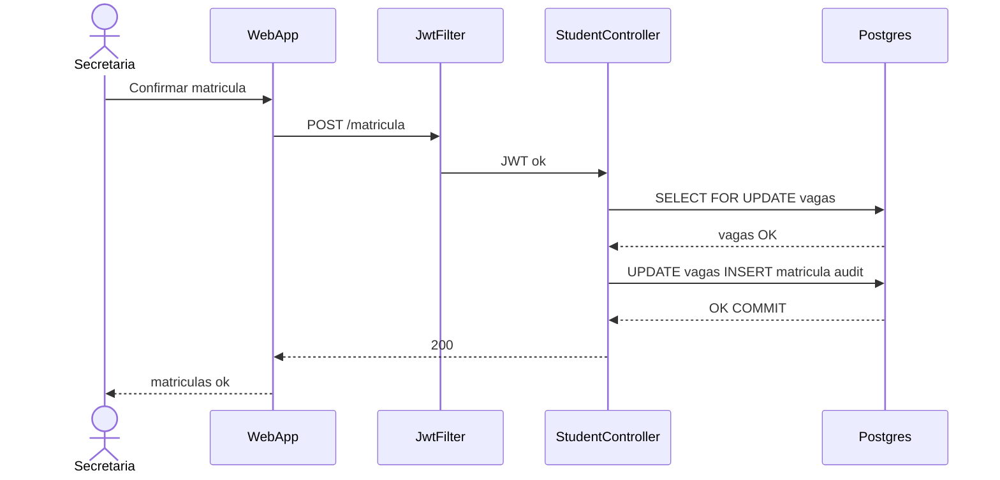

# F5.6-D05 — Matrícula em disciplina

| Campo | Valor |
|---|---|
| HU | US-F5-003 |
| Escopo | POST matrícula + `SELECT FOR UPDATE` vagas + audit |
| Atores | Secretaria, WebApp, JwtFilter, StudentController, Postgres |
| Pré-condições | `user.manage_students`; `_links.matricula`; vagas disponíveis |
| Origem | `docs/tcc-docs.md` §8.6 · RN-F5-003-06 |

## Passos

1. Secretaria confirma disciplinas do período vigente.
2. `SELECT … FOR UPDATE` nas disciplinas; vagas = 0 → F5.6-ERRO-02 (sem TX).
3. TX: decrementa vagas + INSERT matrícula (+ `audit_log`); sem outbox neste fluxo.

## Mermaid

## Export

[`F5.6-D05-matricula.puml`](./F5.6-D05-matricula.puml)
