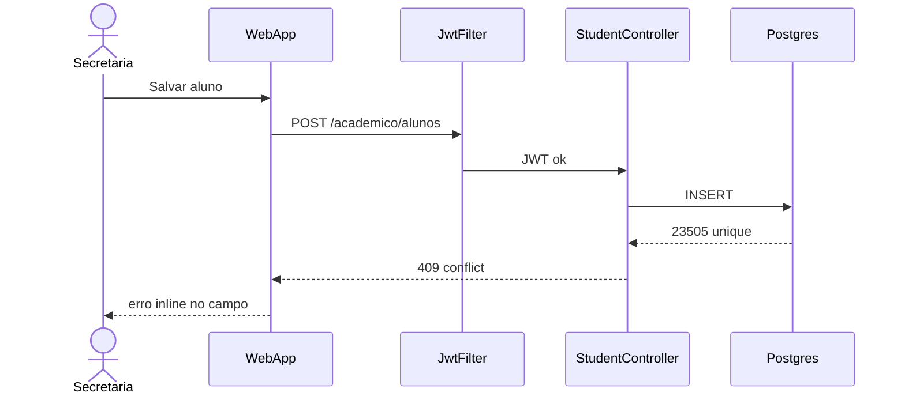

# F5.6-ERRO-01 — 409 conflito de GRR ou CPF

| Campo | Valor |
|---|---|
| HU | US-F5-003 |
| Escopo | unicidade violada no cadastro |
| Atores | Secretaria, WebApp, JwtFilter, StudentController, Postgres |
| Pré-condições | POST cadastro; GRR ou CPF já existe |
| Origem | `docs/tcc-docs.md` §8.6 · CA-05 · RN-F5-003-04 |

## Passos

1. POST com GRR/CPF duplicado.
2. Postgres `23505` → Problem Details `conflict` com `field`.
3. Drawer permanece aberto; campo em danger.

## Mermaid

## Export

[`F5.6-ERRO-01-conflito-grr.puml`](./F5.6-ERRO-01-conflito-grr.puml)
