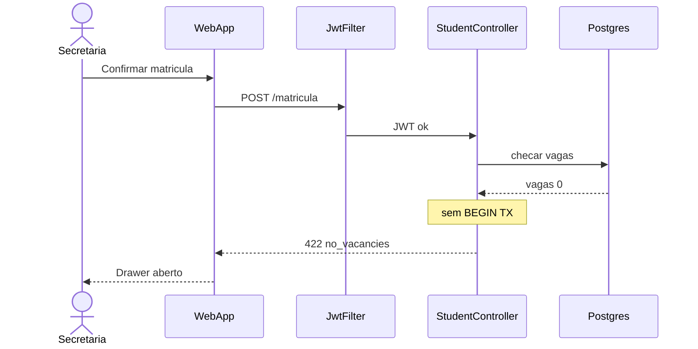

# F5.6-ERRO-02 — 422 matrícula sem vagas

| Campo | Valor |
|---|---|
| HU | US-F5-003 |
| Escopo | disciplina com `vagas_disponiveis = 0` antes da TX |
| Atores | Secretaria, WebApp, JwtFilter, StudentController, Postgres |
| Pré-condições | ao menos uma disciplina sem vaga |
| Origem | `docs/tcc-docs.md` §8.6 · RN-F5-003-06 |

## Passos

1. POST matrícula com disciplina esgotada.
2. Verificação **antes** do BEGIN TX → `422 no_vacancies` (+ `disciplinaId`).
3. Drawer aberto; operadora desmarca a disciplina e reenvia.

## Mermaid

## Export

[`F5.6-ERRO-02-sem-vagas.puml`](./F5.6-ERRO-02-sem-vagas.puml)
