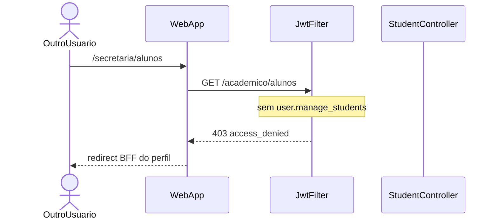

# F5.6-ERRO-03 — 403 sem user.manage_students

| Campo | Valor |
|---|---|
| HU | US-F5-003 |
| Escopo | acesso à gestão de alunos sem capability |
| Atores | OutroUsuario, WebApp, JwtFilter, StudentController |
| Pré-condições | JWT válido; sem `user.manage_students` |
| Origem | `docs/tcc-docs.md` §8.6 · RN-F5-003-01 |

## Passos

1. Tentativa de acessar `/secretaria/alunos` ou API.
2. `@PreAuthorize` → `403 access_denied` antes de query.
3. Frontend redireciona ao BFF do perfil (padrão F5.1-D03).

## Mermaid

## Export

[`F5.6-ERRO-03-sem-manage-students.puml`](./F5.6-ERRO-03-sem-manage-students.puml)
