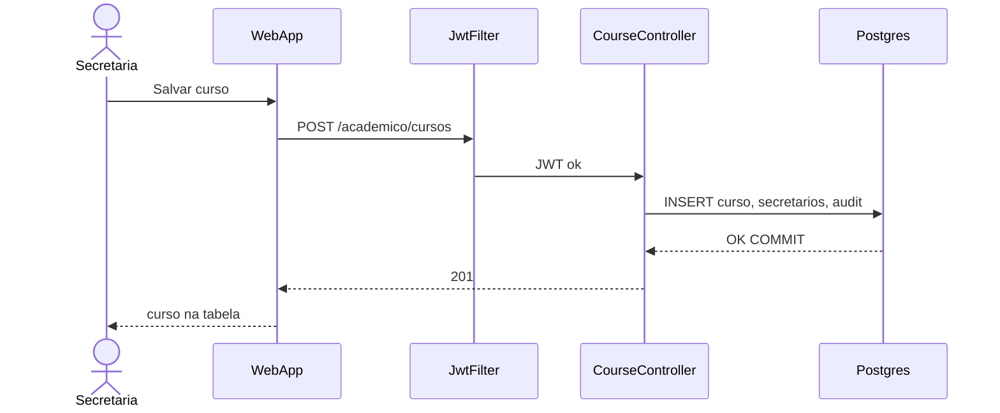

# F5.7-D01 — Criar curso com secretários

| Campo | Valor |
|---|---|
| HU | US-F5-004 |
| Escopo | `POST` curso + vínculos `curso_secretario` + `audit_log` |
| Atores | Secretaria, WebApp, JwtFilter, CourseController, Postgres |
| Pré-condições | `course.manage`; coordenador e secretários existem |
| Origem | `docs/tcc-docs.md` §8.6 · CA-01 · RN-F5-004-03 |

## Passos

1. Secretaria salva Nome, Sigla, Coordenador, horas formativas e Secretários.
2. TX: INSERT curso + `curso_secretario` + `audit_log` (tudo ou nada).
3. Vínculo alimenta `cursoIds[]` / `request.view_curso` (re-emissão de token se necessário).

## Mermaid

## Export

[`F5.7-D01-criar-curso.puml`](./F5.7-D01-criar-curso.puml)
