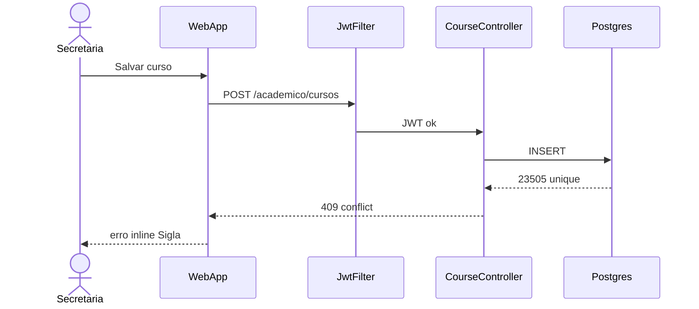

# F5.7-ERRO-01 — 409 sigla de curso duplicada

| Campo | Valor |
|---|---|
| HU | US-F5-004 |
| Escopo | unicidade de sigla no cadastro de curso |
| Atores | Secretaria, WebApp, JwtFilter, CourseController, Postgres |
| Pré-condições | sigla já existe em `curso` |
| Origem | `docs/tcc-docs.md` §8.6 · CA-02 · RN-F5-004-02 |

## Passos

1. POST com sigla duplicada (ex.: TADS).
2. Postgres `23505` → Problem Details `conflict` no campo Sigla.
3. Formulário permanece aberto.

## Mermaid

## Export

[`F5.7-ERRO-01-sigla-duplicada.puml`](./F5.7-ERRO-01-sigla-duplicada.puml)
