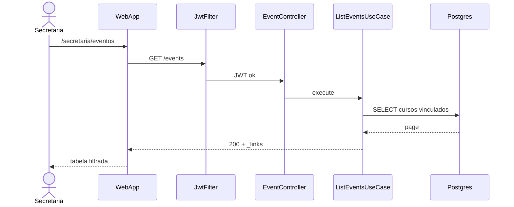

# F5.8-D01 — Listar eventos (secretaria)

| Campo | Valor |
|---|---|
| HU | US-F5-008 |
| Escopo | eventos dos cursos vinculados + `_links` por estado |
| Atores | Secretaria, WebApp, JwtFilter, EventController, ListEventsUseCase, Postgres |
| Pré-condições | `event.manage`; `/secretaria/eventos` |
| Origem | `docs/tcc-docs.md` §8.6 · CA-01 · RN-F5-008-02 |

## Passos

1. Secretaria abre a lista.
2. UseCase resolve `cursoIds` da secretaria (não só `onlyMine`).
3. `CONCLUIDO` sem editar/excluir; `_links.host` se `event.host`; `_links.novoEvento` com `event.manage`.

## Mermaid

## Export

[`F5.8-D01-listar-eventos-secretaria.puml`](./F5.8-D01-listar-eventos-secretaria.puml)
