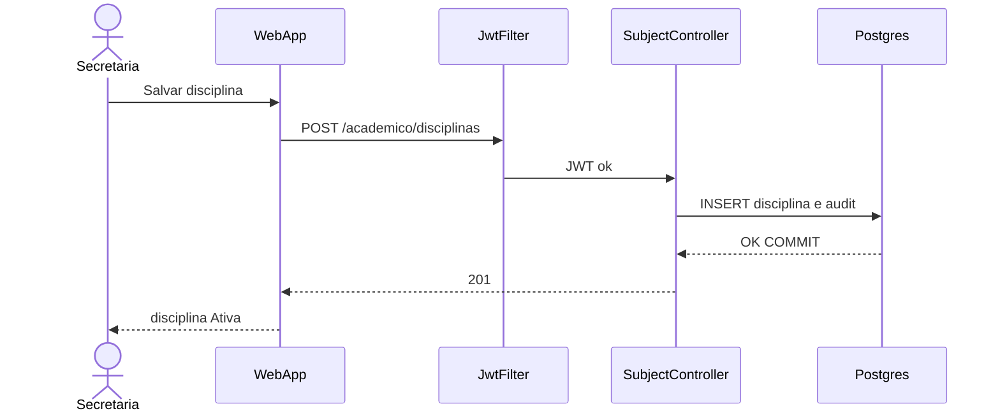

# F5.8-D02 — Criar disciplina

| Campo | Valor |
|---|---|
| HU | US-F5-004 |
| Escopo | `POST /academico/disciplinas` + `audit_log` |
| Atores | Secretaria, WebApp, JwtFilter, SubjectController, Postgres |
| Pré-condições | `subject.manage`; `cursoId` existe |
| Origem | `docs/tcc-docs.md` §8.6 · CA-03 |

## Passos

1. Secretaria salva Nome, Código, Curso e CH.
2. TX: INSERT disciplina (`ativa=true`) + `audit_log`.
3. `codigo` UNIQUE por curso → `409` se duplicado (padrão F5.7-ERRO-01, DRY).

## Mermaid

## Export

[`F5.8-D02-criar-disciplina.puml`](./F5.8-D02-criar-disciplina.puml)
