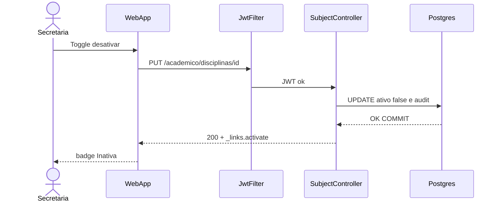

# F5.8-D03 — Desativar disciplina

| Campo | Valor |
|---|---|
| HU | US-F5-004 |
| Escopo | PUT `ativo=false` + `audit_log`; matrículas preservadas |
| Atores | Secretaria, WebApp, JwtFilter, SubjectController, Postgres |
| Pré-condições | `subject.manage`; disciplina ativa |
| Origem | `docs/tcc-docs.md` §8.6 · CA-04 · RN-F5-004-07 |

## Passos

1. Secretaria usa o toggle Desativar.
2. PUT com `ativo=false` (não há PATCH nessa tela — CA-04).
3. Matrículas existentes permanecem; `_links` troca `deactivate` ↔ `activate`.

## Mermaid

## Export

[`F5.8-D03-desativar-disciplina.puml`](./F5.8-D03-desativar-disciplina.puml)
