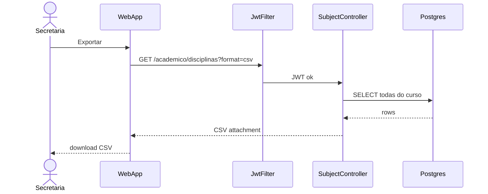

# F5.8-D04-CSV — Exportar CSV de disciplinas

| Campo | Valor |
|---|---|
| HU | US-F5-004 |
| Escopo | `GET ?format=csv` síncrono do curso corrente |
| Atores | Secretaria, WebApp, JwtFilter, SubjectController, Postgres |
| Pré-condições | `subject.manage`; ≥ 1 disciplina |
| Origem | `docs/tcc-docs.md` §8.6 · RN-F5-004-08 |

## Passos

1. Secretaria clica Exportar (mesmos filtros da tela).
2. Backend monta CSV de todas as disciplinas do curso (sem LIMIT de página).
3. `Content-Disposition` + UTF-8 BOM (padrão F5.5-D05).

## Mermaid

## Export

[`F5.8-D04-CSV-exportar-disciplinas.puml`](./F5.8-D04-CSV-exportar-disciplinas.puml)
