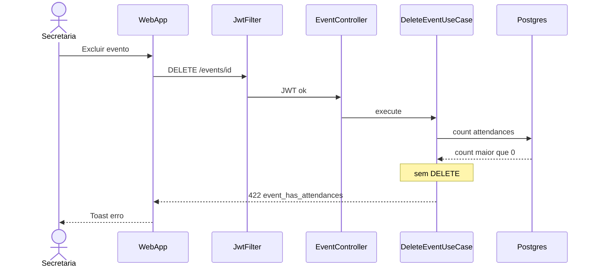

# F5.8-ERRO — 422 excluir evento com presença

| Campo | Valor |
|---|---|
| HU | US-F5-008 |
| Escopo | DELETE de `AGENDADO` com `attendance_session` existente |
| Atores | Secretaria, WebApp, JwtFilter, EventController, DeleteEventUseCase, Postgres |
| Pré-condições | `event.manage`; ≥ 1 presença (inconsistência) |
| Origem | `docs/tcc-docs.md` §8.6 · CA-05 · RN-F5-008-06 |

## Passos

1. Tentativa de excluir.
2. Guards: não `AGENDADO` → `409`; com presença → `422 event_has_attendances`.
3. Linha permanece; normalmente `_links.excluir` já ausente em outros estados.

## Mermaid

## Export

[`F5.8-ERRO-evento-com-presenca.puml`](./F5.8-ERRO-evento-com-presenca.puml)
