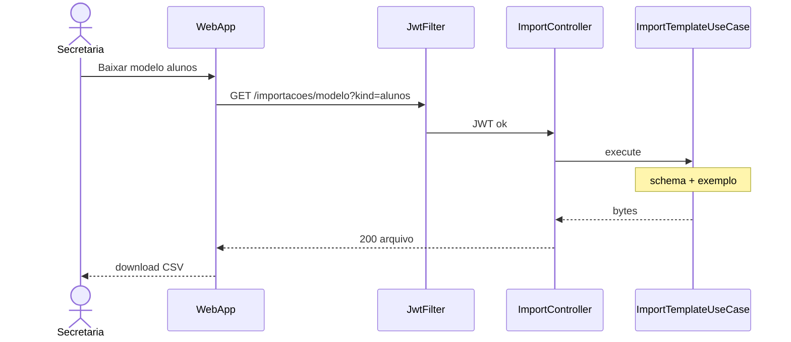

# F5.9-D01 — Baixar modelo de importação

| Campo | Valor |
|---|---|
| HU | US-F5-009 |
| Escopo | download do CSV/XLSX modelo por `kind` (inline) |
| Atores | Secretaria, WebApp, JwtFilter, ImportController, ImportTemplateUseCase |
| Pré-condições | `import.run`; wizard `/secretaria/importacoes` |
| Origem | `docs/tcc-docs.md` §8.6 · CA-01 · RN-F5-009-11 |

## Passos

1. Secretaria escolhe kind (alunos, disciplinas, usuários, alocação).
2. UseCase gera schema + linha de exemplo (sem dados reais / sem MinIO).
3. Resposta HTTP com bytes do arquivo.

## Mermaid

## Export

[`F5.9-D01-baixar-modelo-importacao.puml`](./F5.9-D01-baixar-modelo-importacao.puml)
