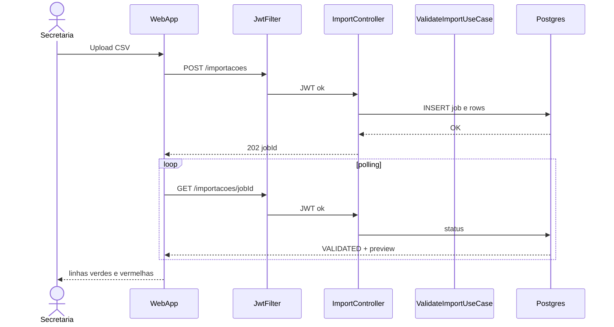

# F5.9-D02 — Upload e validação assíncrona

| Campo | Valor |
|---|---|
| HU | US-F5-009 |
| Escopo | cria `import_job` + polling até `VALIDATED` / preview |
| Atores | Secretaria, WebApp, JwtFilter, ImportController, ValidateImportUseCase, Postgres |
| Pré-condições | `import.run`; arquivo ≤ 20 MB e ≤ 10.000 linhas |
| Origem | `docs/tcc-docs.md` §8.6 · CA-02 · RN-F5-009-07 |

## Passos

1. Upload → TX: job + rows `PENDING`.
2. Worker valida linhas (`VALID` / `WARNING` / `INVALID`); job → `VALIDATED`.
3. Frontend faz polling (~2 s); Confirmar só se `errorCount = 0`.

## Mermaid

## Export

[`F5.9-D02-upload-validacao-importacao.puml`](./F5.9-D02-upload-validacao-importacao.puml)
