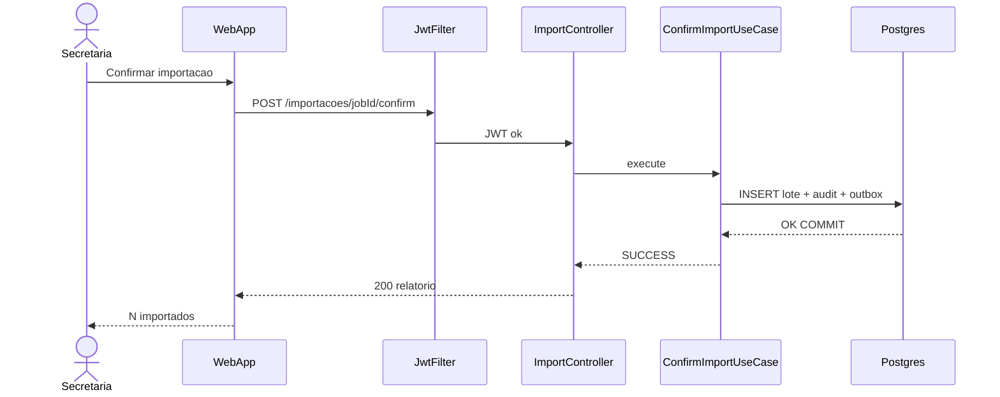

# F5.9-D03 — Confirmar importação

| Campo | Valor |
|---|---|
| HU | US-F5-009 |
| Escopo | lotes de 1.000 + `audit_log` + outbox sumário |
| Atores | Secretaria, WebApp, JwtFilter, ImportController, ConfirmImportUseCase, Postgres |
| Pré-condições | `import.run`; job `VALIDATED`; `errorCount = 0`; `_links.confirm` |
| Origem | `docs/tcc-docs.md` §8.6 · CA-03 · RN-F5-009-09 |

## Passos

1. Secretaria confirma.
2. Processa em lotes de 1.000 (cada lote com TX própria se N grande).
3. Lote final: `audit_log` (checksum, totais) + `outbox_event` (`imports.completed`) → e-mail sumário.

## Mermaid

## Export

[`F5.9-D03-confirmar-importacao.puml`](./F5.9-D03-confirmar-importacao.puml)
