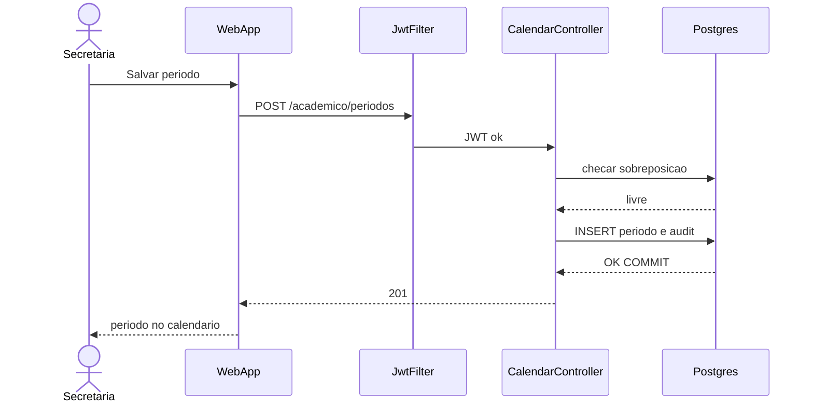

# F5.9-D05 — Criar período letivo

| Campo | Valor |
|---|---|
| HU | US-F5-004 |
| Escopo | `POST /academico/periodos` + checagem de sobreposição + audit |
| Atores | Secretaria, WebApp, JwtFilter, CalendarController, Postgres |
| Pré-condições | `calendar.manage`; sem sobreposição global de datas |
| Origem | `docs/tcc-docs.md` §8.6 · CA-05 · CA-06 · RN-F5-004-12 |

## Passos

1. Secretaria cria período (ex.: 2026/2).
2. Checagem de sobreposição **antes** da TX (período global — sem `id_curso`, CA-06).
3. TX: INSERT + `audit_log`; remove alerta de “sem período vigente” no próximo refresh do BFF.

## Mermaid

## Export

[`F5.9-D05-criar-periodo.puml`](./F5.9-D05-criar-periodo.puml)
