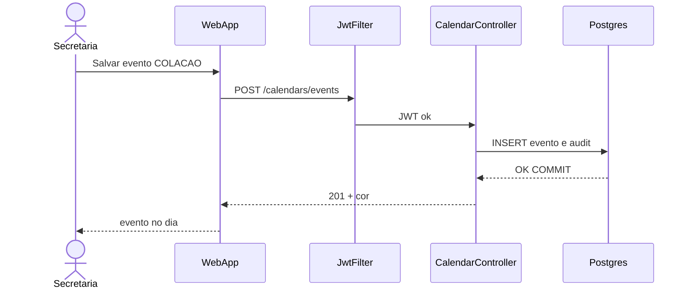

# F5.9-D06 — Criar evento de calendário

| Campo | Valor |
|---|---|
| HU | US-F5-004 |
| Escopo | `POST` evento com tipo semântico + cor + audit |
| Atores | Secretaria, WebApp, JwtFilter, CalendarController, Postgres |
| Pré-condições | `calendar.manage`; período letivo vigente |
| Origem | `docs/tcc-docs.md` §8.6 · CA-07 · RN-F5-004-11 |

## Passos

1. Secretaria cria evento (ex.: `COLACAO`).
2. Backend grava tipo enum + `cor` semântica (`purple`/`gray`/`orange`/`blue`).
3. Vários eventos na mesma data são permitidos; PATCH/DELETE DRY (sem diagrama extra).

## Mermaid

## Export

[`F5.9-D06-criar-evento-calendario.puml`](./F5.9-D06-criar-evento-calendario.puml)
