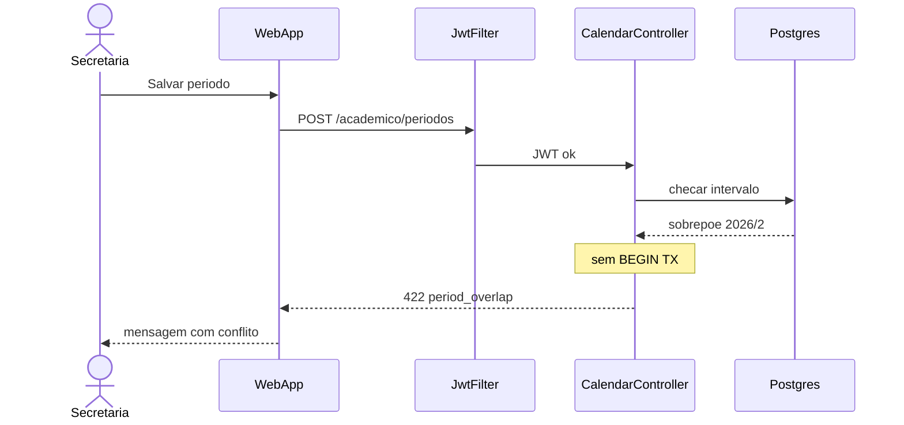

# F5.9-ERRO-02 — 422 sobreposição de período letivo

| Campo | Valor |
|---|---|
| HU | US-F5-004 |
| Escopo | datas sobrepostas a período existente (global) |
| Atores | Secretaria, WebApp, JwtFilter, CalendarController, Postgres |
| Pré-condições | já existe período com intervalo conflitante |
| Origem | `docs/tcc-docs.md` §8.6 · CA-06 · RN-F5-004-12 |

## Passos

1. POST com intervalo que sobrepõe período existente.
2. Query de sobreposição **antes** da TX → `422 period_overlap` (+ `conflictsWithNome`).
3. Modal permanece aberto para ajustar datas.

## Mermaid

## Export

[`F5.9-ERRO-02-sobreposicao-periodo.puml`](./F5.9-ERRO-02-sobreposicao-periodo.puml)
