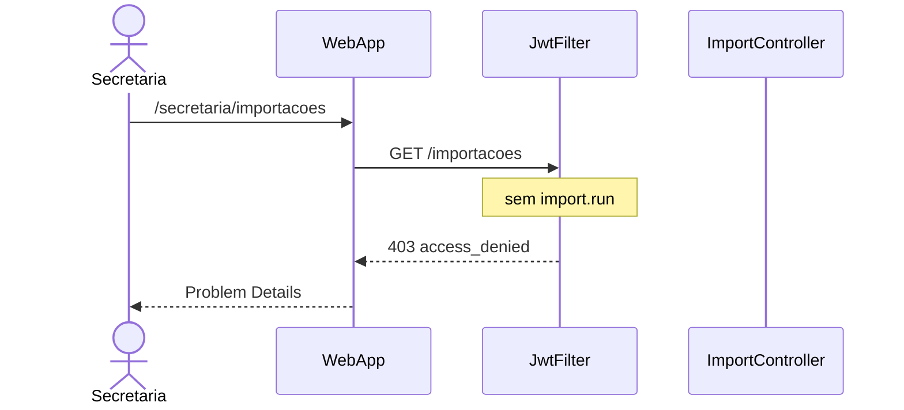

# F5.9-ERRO-403 — 403 sem import.run

| Campo | Valor |
|---|---|
| HU | US-F5-009 |
| Escopo | acesso à importação sem capability |
| Atores | Secretaria, WebApp, JwtFilter, ImportController |
| Pré-condições | JWT válido; `import.run` ausente |
| Origem | `docs/tcc-docs.md` §8.6 |

## Passos

1. Tentativa de iniciar importação / acessar rota.
2. JwtFilter → `403 access_denied` antes de query.

## Mermaid

## Export

[`F5.9-ERRO-403-sem-import-run.puml`](./F5.9-ERRO-403-sem-import-run.puml)
