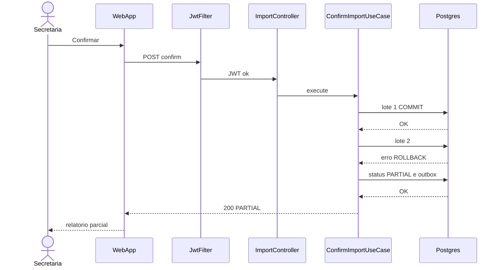

# F5.9-ERRO-D04 — Processamento parcial

| Campo | Valor |
|---|---|
| HU | US-F5-009 |
| Escopo | lote 1 OK; lote 2 falha → job `PARTIAL` |
| Atores | Secretaria, WebApp, JwtFilter, ImportController, ConfirmImportUseCase, Postgres |
| Pré-condições | job `VALIDATED`; ~2.500 linhas (múltiplos lotes) |
| Origem | `docs/tcc-docs.md` §8.6 · CA-04 · RN-F5-009-08 |

## Passos

1. Lote 1 COMMIT (irreversível).
2. Lote 2 ROLLBACK; lotes seguintes não executam.
3. TX de finalização: status `PARTIAL` + outbox com sumário do erro.

## Mermaid

## Export

[`F5.9-ERRO-D04-parcial.puml`](./F5.9-ERRO-D04-parcial.puml)
