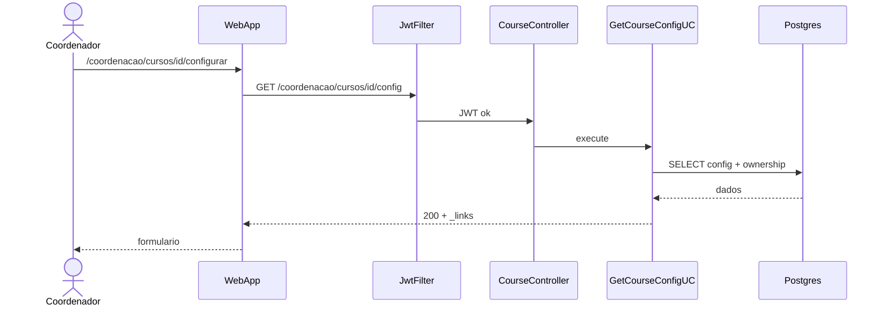

# F6.1-D01 — Carregar configuração do curso

| Campo | Valor |
|---|---|
| HU | US-F6-001 |
| Escopo | `GET` config → formulário; ownership do coordenador |
| Atores | Coordenador, WebApp, JwtFilter, CourseController, GetCourseConfigUC, Postgres |
| Pré-condições | `course.config`; `coordenador_id = userId` |
| Origem | `docs/tcc-docs.md` §8.7 · CA-01 · RN-F6-001-09 |

## Passos

1. Coordenador abre `/coordenacao/cursos/:id/configurar`.
2. UC verifica ownership; falha → F6.1-ERRO.
3. `_links.update` se `course.config`; Salvar só com `isDirty` (client).

## Mermaid

## Export

[`F6.1-D01-carregar-config-curso.puml`](./F6.1-D01-carregar-config-curso.puml)
