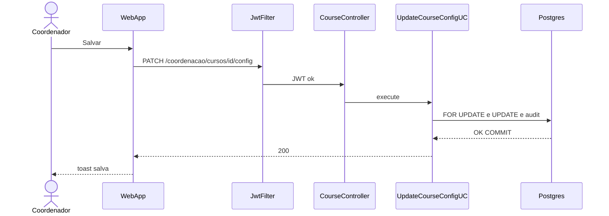

# F6.1-D02 — Salvar configuração do curso

| Campo | Valor |
|---|---|
| HU | US-F6-001 |
| Escopo | `PATCH` + `FOR UPDATE` + `audit_log` (diff) |
| Atores | Coordenador, WebApp, JwtFilter, CourseController, UpdateCourseConfigUC, Postgres |
| Pré-condições | `_links.update`; `isDirty`; ownership OK |
| Origem | `docs/tcc-docs.md` §8.7 · CA-02 · RN-F6-001-06 |

## Passos

1. Coordenador salva campos dirty (ex.: horas formativas 120 → 150).
2. TX: `SELECT FOR UPDATE` + UPDATE + `audit_log` por campo alterado.
3. Não-retroativo: não recalcula elegibilidades já existentes (CA-05).

## Mermaid

## Export

[`F6.1-D02-salvar-config-curso.puml`](./F6.1-D02-salvar-config-curso.puml)
