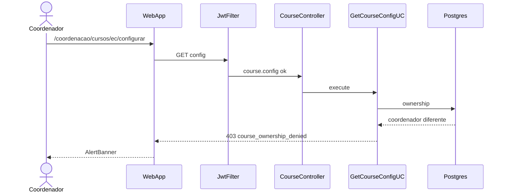

# F6.1-ERRO — 403 curso alheio

| Campo | Valor |
|---|---|
| HU | US-F6-001 |
| Escopo | `coordenador_id ≠ userId` no GET/PATCH config |
| Atores | Coordenador, WebApp, JwtFilter, CourseController, GetCourseConfigUC, Postgres |
| Pré-condições | `course.config` OK; ownership falha |
| Origem | `docs/tcc-docs.md` §8.7 · CA-04 |

## Passos

1. Acesso a `/coordenacao/cursos/ec/configurar` (outro curso).
2. Capability passa; UC de ownership → `403 course_ownership_denied`.
3. AlertBanner: “Você não é coordenador deste curso”.

## Mermaid

## Export

[`F6.1-ERRO-curso-alheio.puml`](./F6.1-ERRO-curso-alheio.puml)
