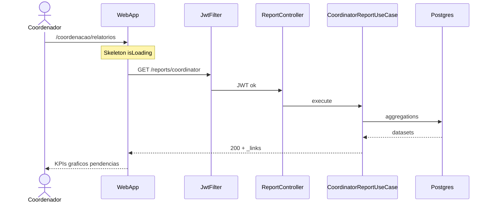

# F6.2-D01 — Relatórios de coordenação (cache MISS)

| Campo | Valor |
|---|---|
| HU | US-F6-002 |
| Escopo | `GET /reports/coordinator` — KPIs + séries + pendências |
| Atores | Coordenador, WebApp, JwtFilter, ReportController, CoordinatorReportUseCase, Postgres |
| Pré-condições | `report.view_coordinator`; cache TanStack MISS |
| Origem | `docs/tcc-docs.md` §8.7 · CA-02 · RN-F6-002-11 |

## Passos

1. Abre `/coordenacao/relatorios` com filtros na URL.
2. UC agrega KPIs, séries e operacionais (paralelo/CTE); Skeleton enquanto carrega.
3. Alert de indeferimento e drill-down no **client**; QuickTiles via `_links`. Cache HIT DRY → F5.18-D02.

## Mermaid

## Export

[`F6.2-D01-relatorios-coordenacao.puml`](./F6.2-D01-relatorios-coordenacao.puml)
