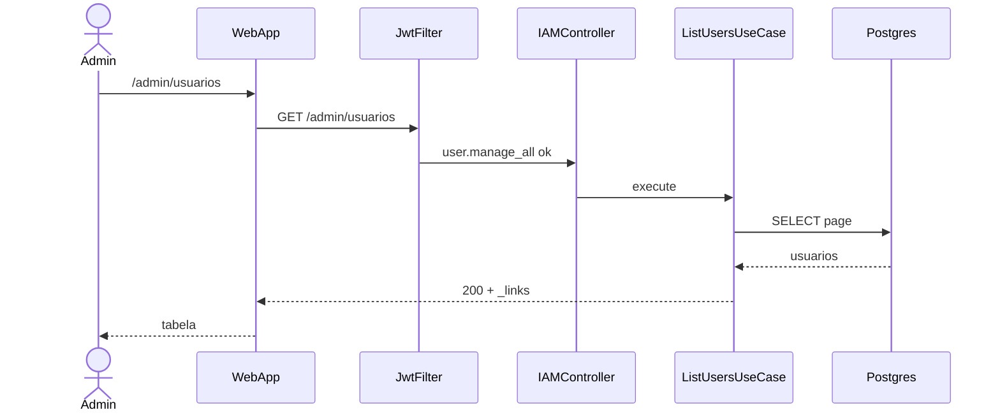

# F7.1-D01 — Listar e filtrar usuários

| Campo | Valor |
|---|---|
| HU | US-F7-001 |
| Escopo | página de usuários + `_links` por linha |
| Atores | Admin, WebApp, JwtFilter, IAMController, ListUsersUseCase, Postgres |
| Pré-condições | `user.manage_all` |
| Origem | `docs/tcc-docs.md` §8.8 · CA-01 · CA-06 |

## Passos

1. Admin abre `/admin/usuarios`.
2. Busca trigrama/e-mail/GRR (debounce 300 ms); page size 20.
3. `_links.deactivate` ausente se `INATIVO`.

## Mermaid

## Export

[`F7.1-D01-listar-usuarios.puml`](./F7.1-D01-listar-usuarios.puml)
