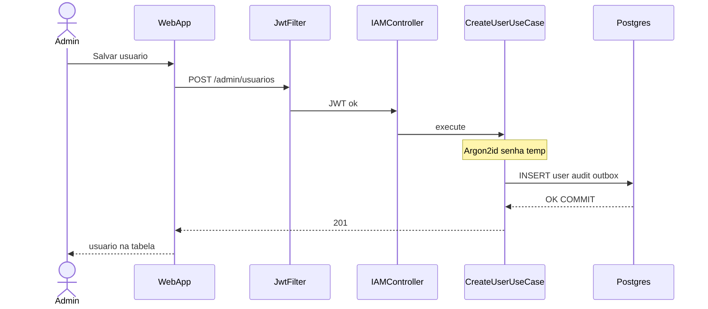

# F7.1-D02 — Criar usuário

| Campo | Valor |
|---|---|
| HU | US-F7-001 |
| Escopo | POST + Argon2id + `mustChangePassword` + outbox |
| Atores | Admin, WebApp, JwtFilter, IAMController, CreateUserUseCase, Postgres |
| Pré-condições | `user.manage_all`; e-mail inexistente |
| Origem | `docs/tcc-docs.md` §8.8 · CA-02 |

## Passos

1. Admin salva Novo usuário.
2. Senha temp em memória + Argon2id **antes** da TX; admin **não** vê a senha.
3. TX: INSERT user (`mustChangePassword=true`) + `audit_log` + `outbox_event` (e-mail de acesso).

## Mermaid

## Export

[`F7.1-D02-criar-usuario.puml`](./F7.1-D02-criar-usuario.puml)
