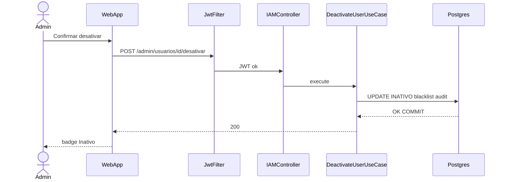

# F7.1-D03 — Desativar usuário

| Campo | Valor |
|---|---|
| HU | US-F7-001 |
| Escopo | `POST .../desativar` + JTI blacklist + audit |
| Atores | Admin, WebApp, JwtFilter, IAMController, DeactivateUserUseCase, Postgres |
| Pré-condições | `user.manage_all`; alvo `ATIVO`; `_links.deactivate` |
| Origem | `docs/tcc-docs.md` §8.8 · CA-03 |

## Passos

1. Admin confirma dialog destrutivo.
2. TX: status `INATIVO` + INSERT `jti_blacklist` (todas as sessões) + `audit_log`.
3. Soft-delete; `_links.deactivate` some na resposta.

## Mermaid

## Export

[`F7.1-D03-desativar-usuario.puml`](./F7.1-D03-desativar-usuario.puml)
