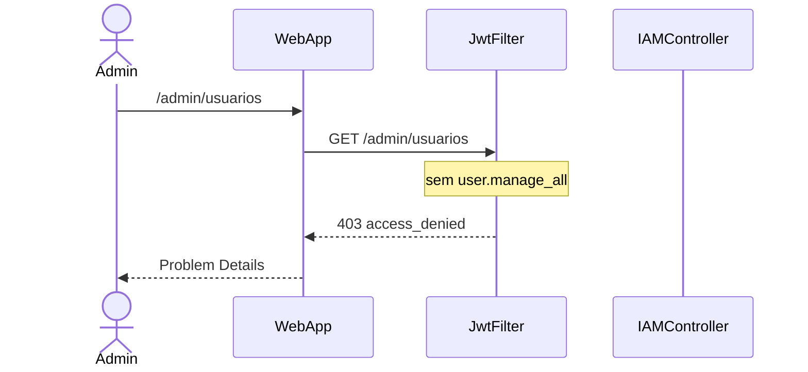

# F7.1-ERRO-01 — 403 sem user.manage_all

| Campo | Valor |
|---|---|
| HU | US-F7-001 |
| Escopo | acesso a `/admin/usuarios` sem capability |
| Atores | Admin, WebApp, JwtFilter, IAMController |
| Pré-condições | JWT válido; sem `user.manage_all` |
| Origem | `docs/tcc-docs.md` §8.8 |

## Passos

1. Tentativa de listar/criar usuários.
2. `@PreAuthorize` → `403 access_denied` antes do UseCase.
3. Mesmo padrão para reset sem `user.reset_password`.

## Mermaid

## Export

[`F7.1-ERRO-01-sem-manage-all.puml`](./F7.1-ERRO-01-sem-manage-all.puml)
