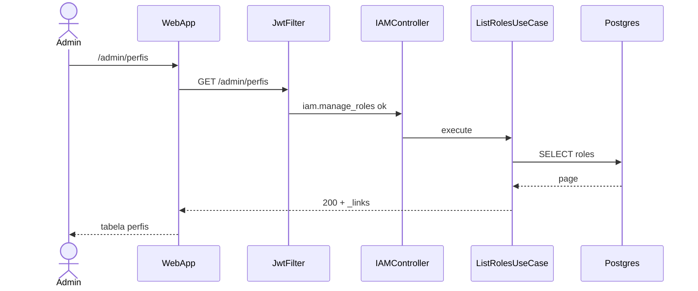

# F7.2-D01 — Listar perfis

| Campo | Valor |
|---|---|
| HU | US-F7-002 |
| Escopo | página de roles + `_links` (delete só custom) |
| Atores | Admin, WebApp, JwtFilter, IAMController, ListRolesUseCase, Postgres |
| Pré-condições | `iam.manage_roles` |
| Origem | `docs/tcc-docs.md` §8.8 · CA-01 |

## Passos

1. Admin abre `/admin/perfis`.
2. API retorna perfis com contagens e badge Sistema/Customizado.
3. `_links.delete` ausente para perfis `SYSTEM` (ALUNO, PROFESSOR, …).

## Mermaid

## Export

[`F7.2-D01-listar-perfis.puml`](./F7.2-D01-listar-perfis.puml)
