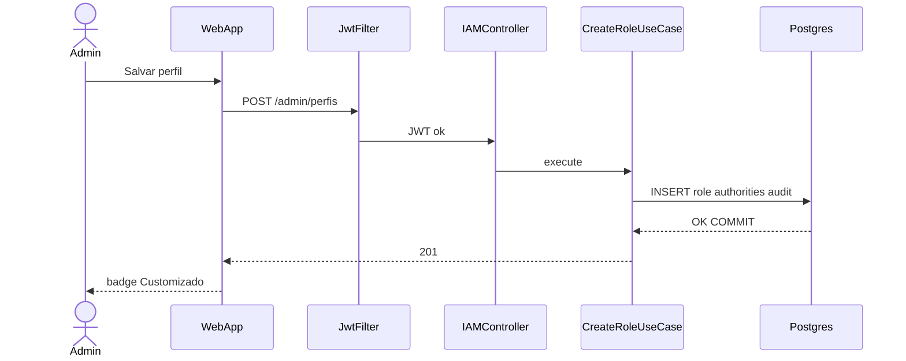

# F7.2-D02 — Criar perfil customizado

| Campo | Valor |
|---|---|
| HU | US-F7-002 |
| Escopo | `POST /admin/perfis` + authorities + audit |
| Atores | Admin, WebApp, JwtFilter, IAMController, CreateRoleUseCase, Postgres |
| Pré-condições | `iam.manage_roles`; nome snake_case livre |
| Origem | `docs/tcc-docs.md` §8.8 · CA-02 |

## Passos

1. Admin salva nome + authorities iniciais.
2. Checagem de nome único; duplicata → `409`.
3. TX: INSERT perfil + `perfil_authority` + `audit_log`.

## Mermaid

## Export

[`F7.2-D02-criar-perfil.puml`](./F7.2-D02-criar-perfil.puml)
