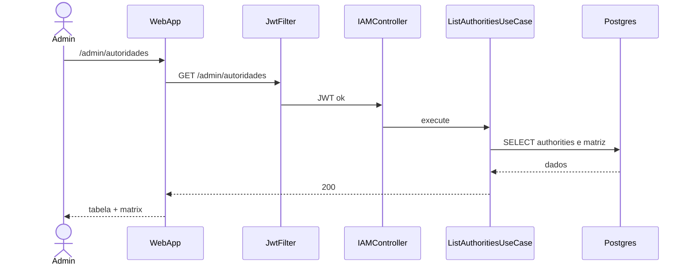

# F7.2-D03 — Listar autoridades e matriz

| Campo | Valor |
|---|---|
| HU | US-F7-002 |
| Escopo | authorities + grade role × authority |
| Atores | Admin, WebApp, JwtFilter, IAMController, ListAuthoritiesUseCase, Postgres |
| Pré-condições | `iam.manage_authorities` |
| Origem | `docs/tcc-docs.md` §8.8 · CA-04 · CA-06 |

## Passos

1. Admin abre `/admin/autoridades`.
2. Resposta traz authorities + dados da `RoleAuthorityMatrix`.
3. `systemDefined` → nome read-only no client; editar descrição = PATCH simples (DRY).

## Mermaid

## Export

[`F7.2-D03-listar-autoridades.puml`](./F7.2-D03-listar-autoridades.puml)
