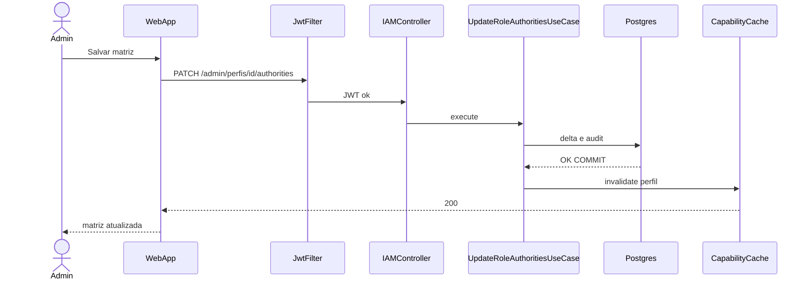

# F7.2-D04 — Salvar matriz role × authority

| Campo | Valor |
|---|---|
| HU | US-F7-002 |
| Escopo | PATCH delta + invalidação de cache de capabilities |
| Atores | Admin, WebApp, JwtFilter, IAMController, UpdateRoleAuthoritiesUseCase, Postgres, CapabilityCache |
| Pré-condições | `iam.manage_roles`; perfil existe |
| Origem | `docs/tcc-docs.md` §8.8 · CA-04 |

## Passos

1. Admin marca/desmarca células e salva.
2. TX aplica delta (add/remove) + `audit_log`.
3. Invalida cache de **todos** os usuários com aquele perfil.

## Mermaid

## Export

[`F7.2-D04-salvar-matriz.puml`](./F7.2-D04-salvar-matriz.puml)
