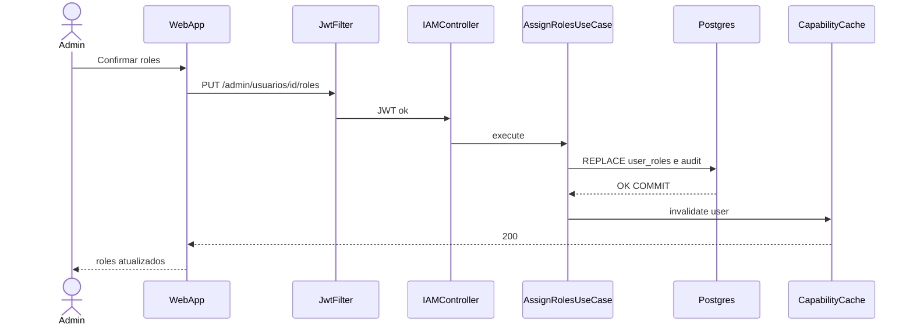

# F7.2-D05 — Atribuir roles a usuário

| Campo | Valor |
|---|---|
| HU | US-F7-002 |
| Escopo | `PUT` conjunto de roles + cache do usuário |
| Atores | Admin, WebApp, JwtFilter, IAMController, AssignRolesUseCase, Postgres, CapabilityCache |
| Pré-condições | `iam.manage_roles`; `_links.manage-roles` (F7.1) |
| Origem | `docs/tcc-docs.md` §8.8 · CA-05 |

## Passos

1. Modal na linha do usuário; confirma nova lista de perfis.
2. TX: REPLACE `user_roles` (DELETE + INSERT) + `audit_log` (diff).
3. Invalida cache de capabilities do alvo.

## Mermaid

## Export

[`F7.2-D05-atribuir-roles.puml`](./F7.2-D05-atribuir-roles.puml)
