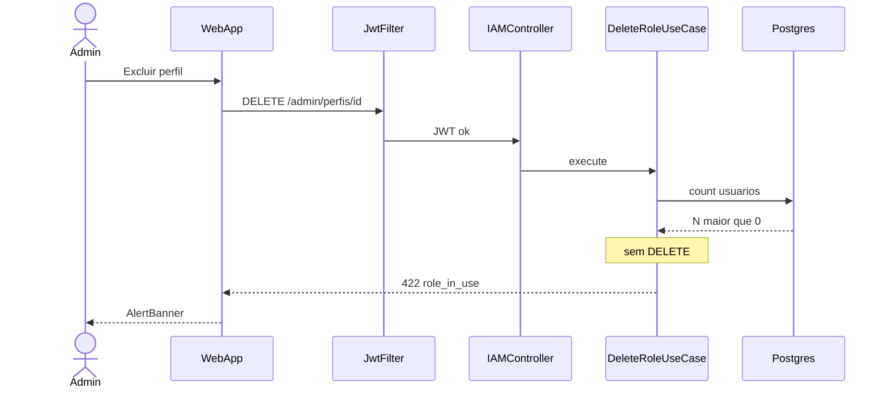

# F7.2-ERRO-01 — 422 excluir perfil em uso

| Campo | Valor |
|---|---|
| HU | US-F7-002 |
| Escopo | perfil CUSTOM ainda atribuído a usuários ativos |
| Atores | Admin, WebApp, JwtFilter, IAMController, DeleteRoleUseCase, Postgres |
| Pré-condições | `iam.manage_roles`; ≥ 1 usuário ativo com o perfil |
| Origem | `docs/tcc-docs.md` §8.8 · CA-03 |

## Passos

1. Tentativa de excluir perfil customizado.
2. Count de usuários > 0 → `422 role_in_use` (sem DELETE).
3. SYSTEM nem chega aqui (sem `_links.delete`).

## Mermaid

## Export

[`F7.2-ERRO-01-perfil-em-uso.puml`](./F7.2-ERRO-01-perfil-em-uso.puml)
