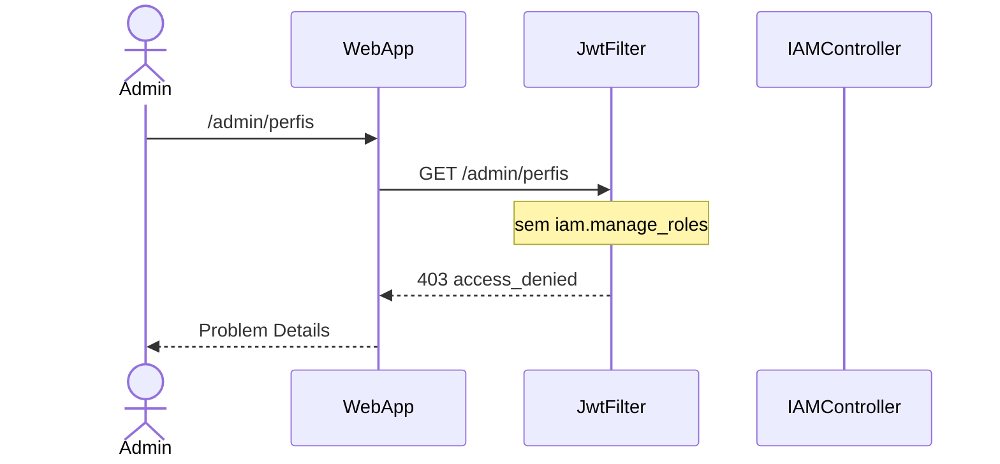

# F7.2-ERRO-02 — 403 sem iam.manage_roles / authorities

| Campo | Valor |
|---|---|
| HU | US-F7-002 |
| Escopo | acesso a perfis ou autoridades sem capability |
| Atores | Admin, WebApp, JwtFilter, IAMController |
| Pré-condições | JWT válido; capability IAM ausente |
| Origem | `docs/tcc-docs.md` §8.8 |

## Passos

1. Tentativa de `/admin/perfis` ou `/admin/autoridades`.
2. `@PreAuthorize` → `403` (DRY F7.1-ERRO-01).

## Mermaid

## Export

[`F7.2-ERRO-02-sem-iam-manage.puml`](./F7.2-ERRO-02-sem-iam-manage.puml)
