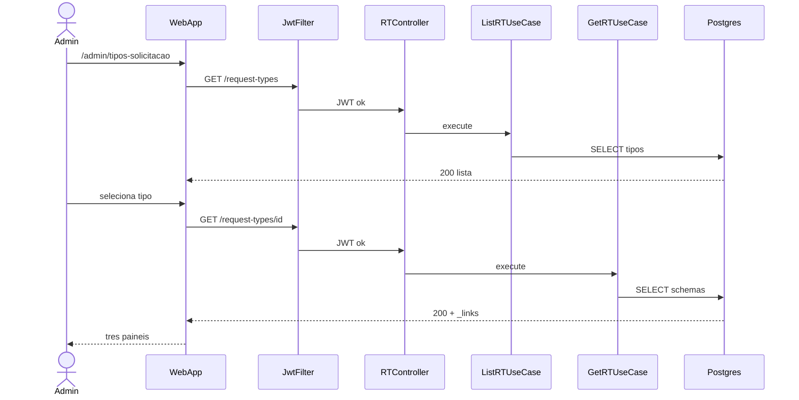

# F7.4-D01 — Listar tipos e carregar editor

| Campo | Valor |
|---|---|
| HU | US-F7-003 |
| Escopo | lista + detalhe → três painéis (JSON + preview) |
| Atores | Admin, WebApp, JwtFilter, RTController, ListRTUseCase, GetRTUseCase, Postgres |
| Pré-condições | `request_type.manage` |
| Origem | `docs/tcc-docs.md` §8.8 · CA-01 |

## Passos

1. Admin abre `/admin/tipos-solicitacao`.
2. Lista com badges `DRAFT`/`PUBLISHED`; seleção carrega `form_schema` + `workflow_json`.
3. Preview/grafo no client; `_links`: `publish`, `save-draft`, `delete` (se elegível).

## Mermaid

## Export

[`F7.4-D01-listar-tipos-solicitacao.puml`](./F7.4-D01-listar-tipos-solicitacao.puml)
