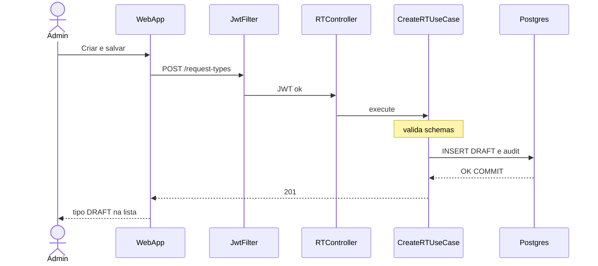

# F7.4-D02 — Criar RequestType (DRAFT)

| Campo | Valor |
|---|---|
| HU | US-F7-003 |
| Escopo | `POST` → status `DRAFT` + audit |
| Atores | Admin, WebApp, JwtFilter, RTController, CreateRTUseCase, Postgres |
| Pré-condições | `request_type.manage`; schemas iniciais |
| Origem | `docs/tcc-docs.md` §8.8 · CA-07 |

## Passos

1. Admin cria tipo (ex.: Monitoria) com schemas.
2. Schema inválido → `422` antes da TX (mesmo guard de F7.4-ERRO-02).
3. TX: INSERT `DRAFT` + `audit_log`; não aparece no wizard F1.8 até publicar.

## Mermaid

## Export

[`F7.4-D02-criar-request-type.puml`](./F7.4-D02-criar-request-type.puml)
