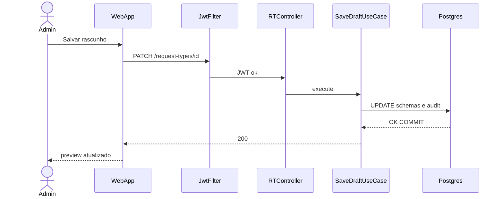

# F7.4-D03 — Salvar rascunho

| Campo | Valor |
|---|---|
| HU | US-F7-003 |
| Escopo | `PATCH` `form_schema` + `workflow_json` (só DRAFT) |
| Atores | Admin, WebApp, JwtFilter, RTController, SaveDraftUseCase, Postgres |
| Pré-condições | tipo `DRAFT`; `request_type.manage` |
| Origem | `docs/tcc-docs.md` §8.8 · CA-02 |

## Passos

1. Admin edita JSONs e salva rascunho (sem publicar).
2. `PUBLISHED` não edita in-place — só via nova publicação.
3. TX: UPDATE schemas + `audit_log`; preview atualiza no client.

## Mermaid

## Export

[`F7.4-D03-salvar-rascunho.puml`](./F7.4-D03-salvar-rascunho.puml)
