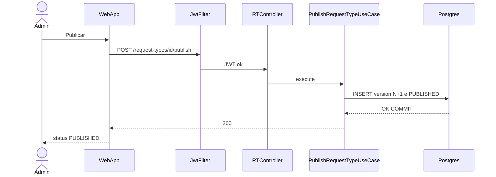

# F7.4-D04 — Publicar versão

| Campo | Valor |
|---|---|
| HU | US-F7-003 |
| Escopo | `POST .../publish` → versão imutável N+1 |
| Atores | Admin, WebApp, JwtFilter, RTController, PublishRequestTypeUseCase, Postgres |
| Pré-condições | `DRAFT`; schemas válidos; `request_type.manage` |
| Origem | `docs/tcc-docs.md` §8.8 · CA-04 · CA-05 |

## Passos

1. Admin clica Publicar.
2. TX: snapshot `request_type_version` N+1 + status `PUBLISHED`.
3. Solicitações abertas mantêm versão anterior; wizard usa current = N+1.

## Mermaid

## Export

[`F7.4-D04-publicar-versao.puml`](./F7.4-D04-publicar-versao.puml)
