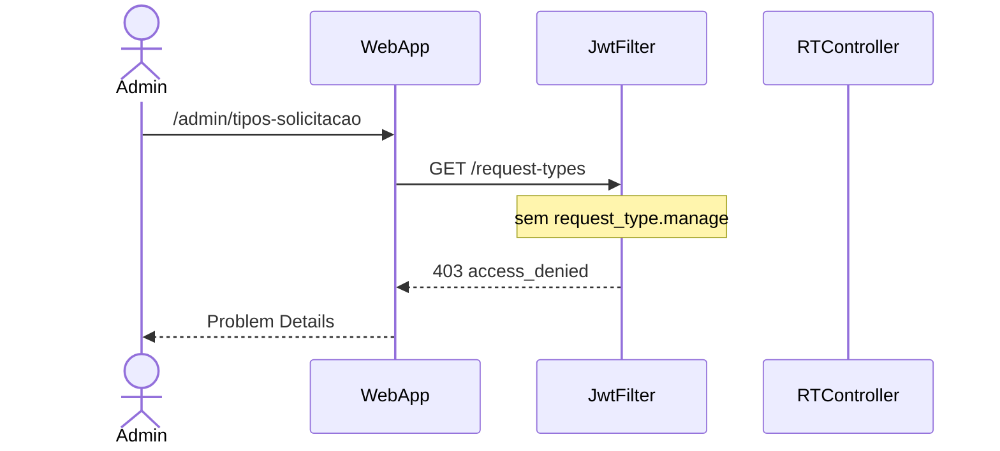

# F7.4-ERRO-01 — 403 sem request_type.manage

| Campo | Valor |
|---|---|
| HU | US-F7-003 |
| Escopo | acesso ao editor sem capability |
| Atores | Admin, WebApp, JwtFilter, RTController |
| Pré-condições | JWT válido; sem `request_type.manage` |
| Origem | `docs/tcc-docs.md` §8.8 |

## Passos

1. Tentativa de `/admin/tipos-solicitacao`.
2. `@PreAuthorize` → `403` (DRY F7.1-ERRO-01).

## Mermaid

## Export

[`F7.4-ERRO-01-sem-request-type-manage.puml`](./F7.4-ERRO-01-sem-request-type-manage.puml)
