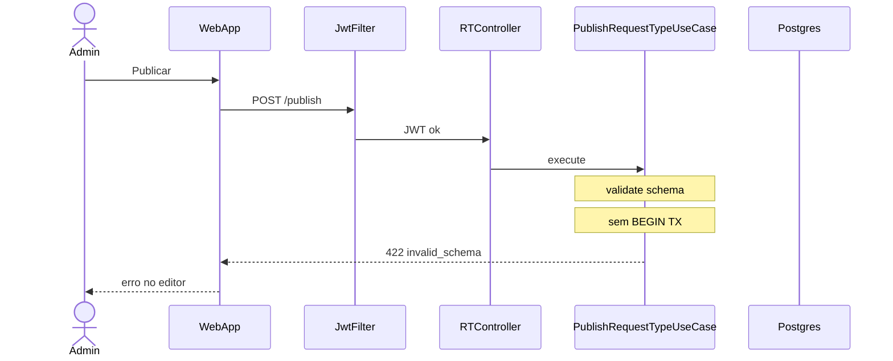

# F7.4-ERRO-02 — 422 schema inválido no publish

| Campo | Valor |
|---|---|
| HU | US-F7-003 |
| Escopo | `form_schema` / `workflow_json` malformado — sem TX |
| Atores | Admin, WebApp, JwtFilter, RTController, PublishRequestTypeUseCase, Postgres |
| Pré-condições | tipo `DRAFT`; JSON inválido |
| Origem | `docs/tcc-docs.md` §8.8 · CA-03 |

## Passos

1. Publicar (ou criar/salvar) com schema inválido.
2. Validate **antes** do BEGIN TX → `422 invalid_schema` / `invalid_workflow`.
3. Monaco no client é best-effort; server é a barreira.

## Mermaid

## Export

[`F7.4-ERRO-02-schema-invalido.puml`](./F7.4-ERRO-02-schema-invalido.puml)
