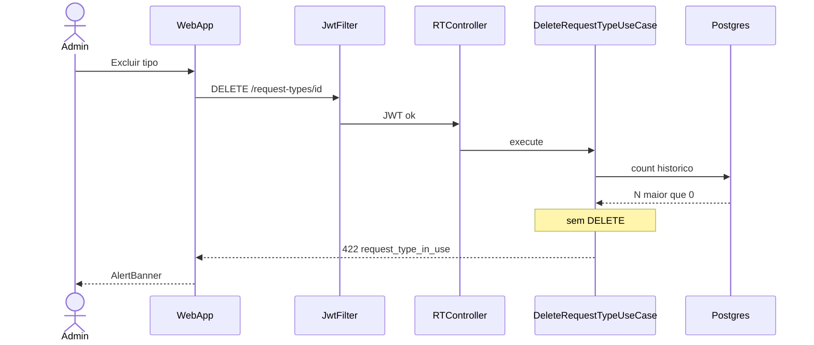

# F7.4-ERRO-03 — 422 excluir RequestType com histórico

| Campo | Valor |
|---|---|
| HU | US-F7-003 |
| Escopo | delete bloqueado se há solicitações ou versões |
| Atores | Admin, WebApp, JwtFilter, RTController, DeleteRequestTypeUseCase, Postgres |
| Pré-condições | `request_type.manage`; tipo com histórico |
| Origem | `docs/tcc-docs.md` §8.8 |

## Passos

1. Tentativa de excluir tipo com vínculos.
2. Guard → `422 request_type_in_use` (sem DELETE).
3. Só `DRAFT` sem versões/solicitações pode ser excluído; `PUBLISHED` sem `_links.delete`.

## Mermaid

## Export

[`F7.4-ERRO-03-tipo-com-historico.puml`](./F7.4-ERRO-03-tipo-com-historico.puml)
