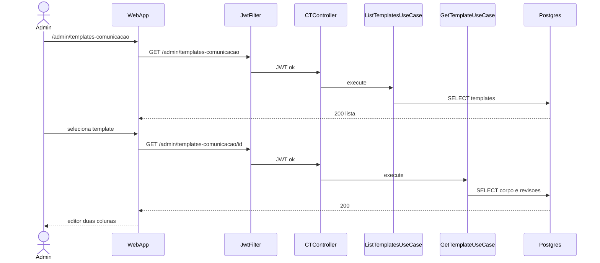

# F7.5-D01 — Listar templates e carregar editor

| Campo | Valor |
|---|---|
| HU | US-F7-004 |
| Escopo | lista + detalhe (Markdown, preview, histórico) |
| Atores | Admin, WebApp, JwtFilter, CTController, ListTemplatesUseCase, GetTemplateUseCase, Postgres |
| Pré-condições | `communication.manage_templates` |
| Origem | `docs/tcc-docs.md` §8.8 · CA-01 |

## Passos

1. Admin abre `/admin/templates-comunicacao` e seleciona um template.
2. Resposta traz corpo, `variaveis[]` e `revisoes[]`.
3. Autocomplete/`{{...}}` e preview no client — sem HTTP extra.

## Mermaid

## Export

[`F7.5-D01-listar-templates.puml`](./F7.5-D01-listar-templates.puml)
