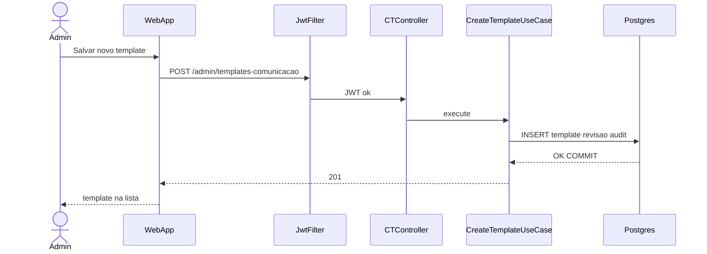

# F7.5-D02 — Criar template

| Campo | Valor |
|---|---|
| HU | US-F7-004 |
| Escopo | `POST` cabeçalho + 1ª revisão + audit |
| Atores | Admin, WebApp, JwtFilter, CTController, CreateTemplateUseCase, Postgres |
| Pré-condições | `communication.manage_templates`; nome dot-notation livre |
| Origem | `docs/tcc-docs.md` §8.8 · CA-04 |

## Passos

1. Admin cria template (ex.: `boas-vindas.egresso`).
2. Nome único; duplicata → `409`.
3. TX: INSERT template + revisão CURRENT + `audit_log`.

## Mermaid

## Export

[`F7.5-D02-criar-template.puml`](./F7.5-D02-criar-template.puml)
