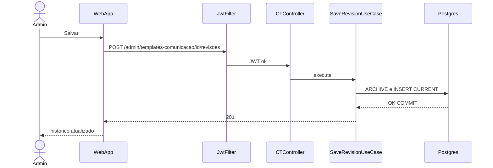

# F7.5-D03 — Salvar revisão

| Campo | Valor |
|---|---|
| HU | US-F7-004 |
| Escopo | nova revisão CURRENT; anterior → ARCHIVED |
| Atores | Admin, WebApp, JwtFilter, CTController, SaveRevisionUseCase, Postgres |
| Pré-condições | template existe; `communication.manage_templates` |
| Origem | `docs/tcc-docs.md` §8.8 · CA-04 |

## Passos

1. Admin edita corpo/assunto e salva.
2. TX: UPDATE revisão atual → `ARCHIVED` + INSERT N+1 `CURRENT` + `audit_log`.
3. Revisões nunca são apagadas (imutabilidade).

## Mermaid

## Export

[`F7.5-D03-salvar-revisao.puml`](./F7.5-D03-salvar-revisao.puml)
