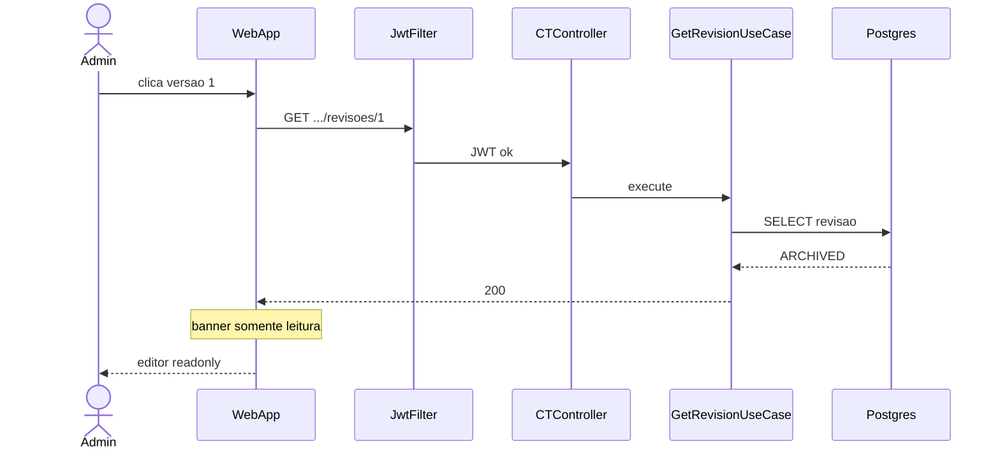

# F7.5-D04 — Carregar versão anterior

| Campo | Valor |
|---|---|
| HU | US-F7-004 |
| Escopo | revisão `ARCHIVED` em modo somente leitura |
| Atores | Admin, WebApp, JwtFilter, CTController, GetRevisionUseCase, Postgres |
| Pré-condições | ≥ 2 revisões; `communication.manage_templates` |
| Origem | `docs/tcc-docs.md` §8.8 · CA-05 |

## Passos

1. Admin clica versão antiga no histórico.
2. GET da revisão; UI readonly se `ARCHIVED` (Salvar desabilitado).
3. Voltar à CURRENT: mesmo endpoint na revisão corrente.

## Mermaid

## Export

[`F7.5-D04-carregar-versao-anterior.puml`](./F7.5-D04-carregar-versao-anterior.puml)
