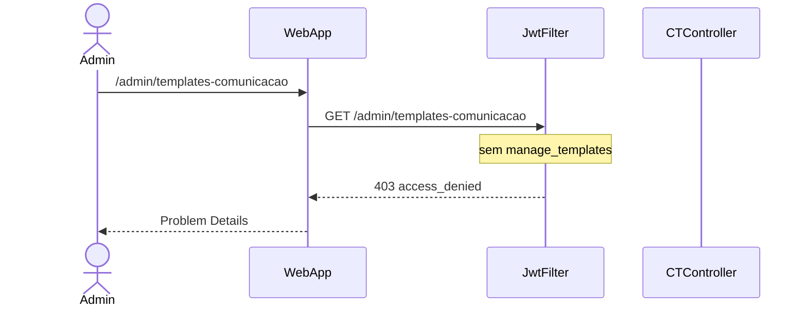

# F7.5-ERRO-01 — 403 sem communication.manage_templates

| Campo | Valor |
|---|---|
| HU | US-F7-004 |
| Escopo | acesso aos templates sem capability |
| Atores | Admin, WebApp, JwtFilter, CTController |
| Pré-condições | JWT válido; capability ausente |
| Origem | `docs/tcc-docs.md` §8.8 |

## Passos

1. Tentativa de `/admin/templates-comunicacao`.
2. `@PreAuthorize` → `403` (DRY F7.1-ERRO-01).

## Mermaid

## Export

[`F7.5-ERRO-01-sem-manage-templates.puml`](./F7.5-ERRO-01-sem-manage-templates.puml)
