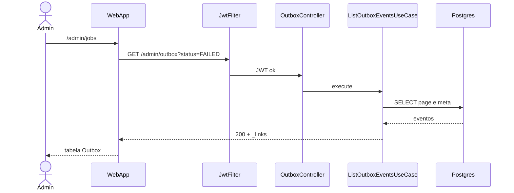

# F7.6-D01 — Listar eventos do Outbox

| Campo | Valor |
|---|---|
| HU | US-F7-005 |
| Escopo | `GET /admin/outbox` por status + latência + HATEOAS |
| Atores | Admin, WebApp, JwtFilter, OutboxController, ListOutboxEventsUseCase, Postgres |
| Pré-condições | `system.observe` |
| Origem | `docs/tcc-docs.md` §8.8 · CA-01 · CA-06 |

## Passos

1. Admin abre `/admin/jobs` (aba FAILED etc.).
2. Página com filtros (`aggregateType`); `meta.oldestPendingMs` → AlertBanner se > 30 s.
3. `_links.retry` só para `FAILED`/`DEAD`.

## Mermaid

## Export

[`F7.6-D01-listar-outbox.puml`](./F7.6-D01-listar-outbox.puml)
