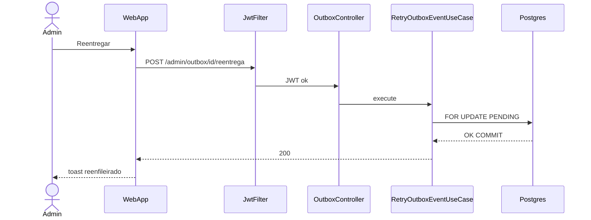

# F7.6-D02 — Reentregar evento FAILED/DEAD

| Campo | Valor |
|---|---|
| HU | US-F7-005 |
| Escopo | `POST /admin/outbox/{id}/reentrega` → `PENDING` |
| Atores | Admin, WebApp, JwtFilter, OutboxController, RetryOutboxEventUseCase, Postgres |
| Pré-condições | status `FAILED` ou `DEAD`; `_links.retry`; `system.observe` |
| Origem | `docs/tcc-docs.md` §8.8 · CA-03 |

## Passos

1. Admin clica Reentregar.
2. `SELECT FOR UPDATE`; TX: status `PENDING`, `tentativas=0`, `retried_by`.
3. Dispatcher pega no próximo ciclo (~5 s); `_links.retry` some (agora PENDING).

## Mermaid

## Export

[`F7.6-D02-reentregar-outbox.puml`](./F7.6-D02-reentregar-outbox.puml)
