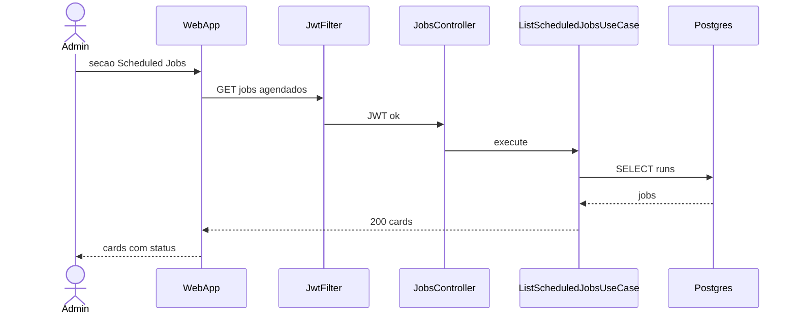

# F7.6-D03 — Listar jobs agendados

| Campo | Valor |
|---|---|
| HU | US-F7-005 |
| Escopo | cards de jobs recorrentes (leitura) |
| Atores | Admin, WebApp, JwtFilter, JobsController, ListScheduledJobsUseCase, Postgres |
| Pré-condições | `system.observe` |
| Origem | `docs/tcc-docs.md` §8.8 · CA-05 |

## Passos

1. Seção Scheduled Jobs em `/admin/jobs`.
2. Backend calcula status `OK` / `ATRASADO` / `FALHOU`.
3. Somente leitura — sem mutação nem audit.

## Mermaid

## Export

[`F7.6-D03-listar-jobs-agendados.puml`](./F7.6-D03-listar-jobs-agendados.puml)
